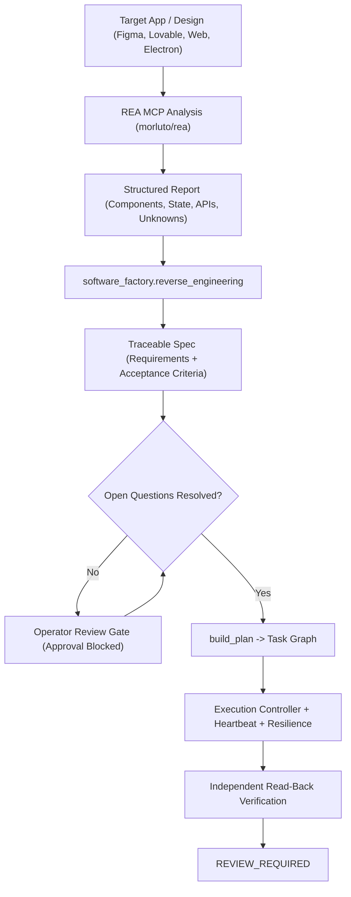

# Reverse-Engineering and Design-to-Spec Integration Guide

**Status:** Implemented bridge and workflow specification  
**Tools:** [REA (Reverse Engineer Anything)](https://github.com/morluto/rea), MCP tools, and `software_factory.reverse_engineering`

---

## 1. Purpose

The AI Software Factory aims to build complex applications (such as design tools like Figma, AI generators like Lovable, marketplaces, or specialized transport platforms). Building such systems requires accurate specifications of:
- UI component hierarchies and layout mechanics
- Reactive state stores and client event pipelines
- Protocol and API payload contracts
- Background worker and synchronization lifecycles

Rather than guessing these architectures, the factory integrates with **REA (`morluto/rea`)**, an open-source, local-first Model Context Protocol (MCP) reverse-engineering toolkit.

---

## 2. Trust Boundaries and Clean-Room Policy

1. **Untrusted Input Boundary**: Decompiled source maps, DOM trees, binary disassembly, or network payloads extracted from reverse engineering are untrusted inputs. They must never be executed directly.
2. **Clean-Room Specification**: The factory translates reverse-engineered structures into formal requirements (`SF-REQ-*`), acceptance criteria, and schema contracts. No proprietary binary code or copyrighted assets are copied directly into generated artifacts.
3. **Surfaced Unknowns as Review Gates**: Any gaps, encrypted protocols, or unverified behaviors discovered during reverse engineering become explicit `open_questions` in the specification. Under factory policy (`SpecStore.approve`), a specification **cannot be approved** until all open questions are resolved by the operator.
4. **Zero-Spend Mandate**: REA runs locally via Node/Python without paid cloud infrastructure.

---

## 3. Workflow Sequence



---

## 4. Using the Bridge in Python

```python
from software_factory.core import Store
from software_factory.specs import SpecStore
from software_factory.reverse_engineering import convert_rea_report_to_specification

# 1. Provide or ingest REA output
analysis_report = {
    "target_name": "Figma-Lovable Design Studio",
    "components": [
        {
            "name": "DesignCanvas",
            "description": "Infinite canvas with zoom and pan transformation",
            "acceptance_criteria": [
                "Canvas handles zoom levels from 10% to 1000%",
                "Pan updates viewport matrix without redrawing full scene"
            ]
        },
        {
            "name": "ComponentPropertyPanel",
            "description": "Inspector panel for element styling and props"
        }
    ],
    "api_contracts": [
        {
            "endpoint": "/api/codegen/component",
            "method": "POST",
            "description": "Generate component code from canvas tree"
        }
    ],
    "inferred_logic": [
        "State synchronization uses local immutable event log."
    ],
    "unknowns": [
        "What is the maximum simultaneous multi-user cursor limit?"
    ]
}

# 2. Convert to validated specification
spec = convert_rea_report_to_specification(
    analysis_report,
    title="Clean-Room Design Studio",
    goal="Provide a verifiable clean-room design-to-code workspace."
)

# 3. Save into Factory Store
store = Store("data/factory.sqlite3")
spec_store = SpecStore(store)
project = store.create_project("Design Studio", spec["goal"])
saved_spec = spec_store.save(project["id"], spec)

# Note: Approval is blocked until open questions are resolved:
print("Open questions requiring review:", spec["open_questions"])
```

---

## 5. REA MCP Configuration

To enable REA as a local tool for AI agents:

```sh
# 1. Install / setup REA agents toolkit locally
npx rea-agents setup

# 2. Confirm MCP server registration in agent config
# (Tools exposed: inspect_app, analyze_binary, extract_components, trace_protocol)
```

The resulting analyses can then be fed directly to `convert_rea_report_to_specification` for verifiable execution in the factory.

